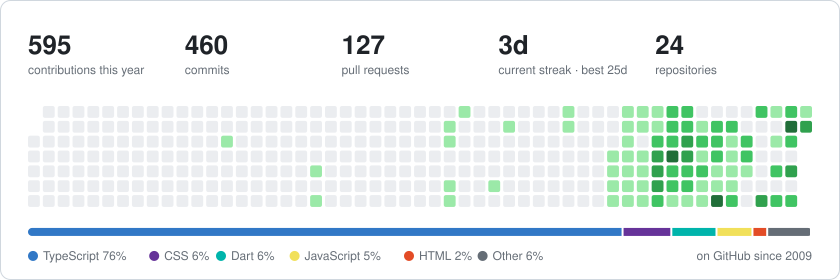

# David Chambers

Front-end engineer and independent consultant with 27+ years of experience.
I build and modernize websites and web apps with React, Next.js, and TypeScript.

## Projects

- [Useless Achievements](https://github.com/zarkasias/useless) — A full-stack web app I built where users earn collectible achievements through daily challenges and browser games.
- [Chambers Consulting](https://chambers-consulting.dev/) — Website modernization and front-end consulting.

## Activity

<picture>
  <source media="(prefers-color-scheme: dark)" srcset="metrics/metrics-dark.svg">
  
</picture>
